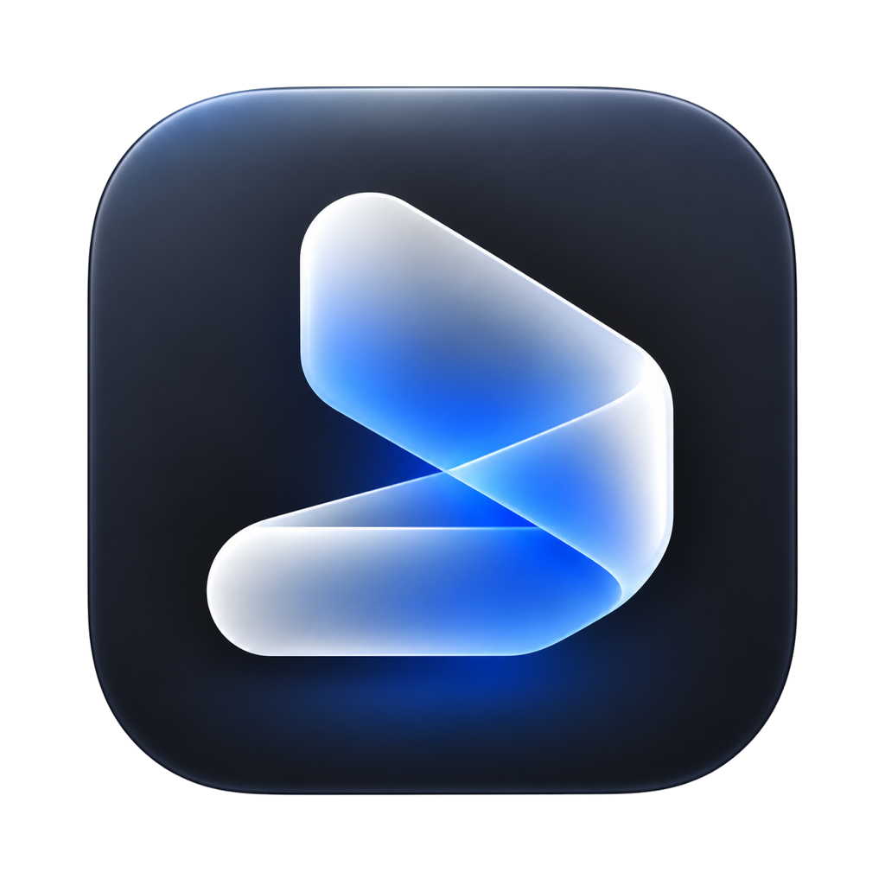

<p align="center"></p>

# SoundScript

Video → transcript → translation, entirely on your Mac. No servers, no API keys, no uploads.

- **Transcription:** [WhisperKit](https://github.com/argmaxinc/WhisperKit) on the Neural Engine.
  - M2/M3/M4: large-v3-turbo (632 MB) by default — near large-v3 quality, much faster.
  - M1: large-v3 626 MB by default, because WhisperKit does not list turbo as supported on M1.
  - Optional `--best` (large-v3, 1.6 GB) or `--small` (216 MB) for quality/speed extremes.
- **Translation:** pick an engine:
  - Apple's on-device Translation framework (no setup, any language pair).
  - [opus-mt-tc-big](https://huggingface.co/Helsinki-NLP/opus-mt-tc-big-en-tr) EN↔TR via CTranslate2: more natural dialogue, ~1 GB one-time install.
- **Links:** paste a URL; SoundScript downloads it with your local `yt-dlp`.
- **Output:** SRT, TXT, side-by-side Markdown, or JSON. SRT lines are wrapped to two readable rows and long sentences are split into timed cues.

## Requirements

- Apple Silicon Mac, macOS 26 or later
- Xcode 26+ (to build)
- Optional: `brew install yt-dlp` for URL input

## Install

```sh
git clone https://github.com/cemtatli/soundscript.git
cd soundscript
swift build -c release
cp .build/release/soundscript /usr/local/bin/   # or anywhere on your PATH
```

## Usage

```sh
soundscript video.mp4                       # transcript + translation as SRT next to the file
soundscript video.mp4 --format md           # side-by-side Markdown table
soundscript "https://…" -o ~/Desktop/clips  # download, then process
soundscript video.mp4 --to en               # translate to English
soundscript video.mp4 --no-translate        # transcript only
soundscript video.mp4 --engine opus         # use opus-mt for EN↔TR
soundscript video.mp4 --best                # large-v3: slowest, most accurate
soundscript video.mp4 --small               # small: fastest, lower accuracy
soundscript models                          # download models ahead of time / show status
soundscript models --best                   # pre-download large-v3
soundscript models --opus                   # install opus-mt (Python venv + both directions)
```

Progress goes to stderr; stdout only lists the files written, so it composes with scripts.

### First run

1. The recommended Whisper model downloads once to `~/Library/Application Support/SoundScript/models`
   (632 MB turbo on M2+; 626 MB large-v3 on M1).
2. Core ML compiles the model for your chip. This takes a few minutes **once**; afterwards a 30-second clip transcribes in about 3 seconds.
3. Translation languages are installed by macOS, not by SoundScript. If a language is missing, SoundScript opens
   **System Settings → General → Language & Region → Translation Languages** for you.
4. The app (Settings → Transkript) can pre-download the model or switch between automatic, most accurate, and fastest.

### opus-mt engine

CTranslate2 has no Swift bindings, so SoundScript runs it through a small Python bridge in its own venv
(`~/Library/Application Support/SoundScript/opus`). Install it from **Settings (⌘,)** or `soundscript models --opus`;
it needs `python3` (Xcode Command Line Tools ship one). The CTranslate2 conversions are pinned to a commit.

## Layout

```
Sources/SoundScriptCore   audio decoding, transcription, translation, exporters (no UI)
Sources/soundscript       command-line interface
Sources/SoundScriptApp    SwiftUI app (library, player, transcript, settings)
Tests/                    unit tests (swift test)
Resources/                app icon (AppIcon.png / AppIcon.icns) and Info.plist
design/logo/              app-icon-artwork.png (icon source)
scripts/                  make-icon.swift (regenerates the icon), bundle.sh (builds SoundScript.app)
```

The app name, command name, bundle id and data folder live in one place: `Sources/SoundScriptCore/AppInfo.swift`.

## Icon

The app icon is generated from `design/logo/app-icon-artwork.png`. After changing the artwork, rebuild both
the PNG and the `.icns` with:

```sh
swift scripts/make-icon.swift
```

## Notes

Downloading from a site is subject to that site's terms. SoundScript does not bundle `yt-dlp`; you install and update it yourself.

## License

MIT
